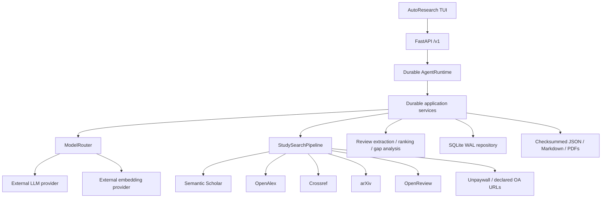

# AutoResearch architecture

## Scope and success criteria

Milestone one implements one durable vertical slice:

```text
seed PDF/DOI/URL
  → multiple concurrent scholarly searches
  → 20 normalized and deduplicated recent papers
  → legal open-access PDF resolution
  → evidence-backed structured reviews
  → transparent top-five ranking
  → one cited research-gap report
```

The design accepts limits up to 100 and review `top_k` up to 15, but the release
default is 20/5. Result-conditioned Reinvention and remote GPU workers remain
disabled. The optional conversational agent and terminal client are thin
controllers over the Python services; they do not move research decisions into
TypeScript.

The mandatory high-level structure is unchanged. Additional internal modules
(`domain/models.py`, `application/config.py`, `application/factory.py`,
`application/services.py`, provider adapter subpackages, and worker/API
contracts) are technically necessary implementations inside the required
directories.

## System design



There is one deployable Python process and one SQLite database. No local model
server, provider SDK, or model-weight dependency exists. Research code imports
`ModelRouter`, never a provider SDK.

## Provider boundary

The ported gateway preserves capability-checked roles, transient-only fallback,
timeouts, retry, pooled HTTP clients, secret redaction, structured output,
usage/cost recording, and project budgets. This milestone adds:

- embeddings routed through `ModelRouter.embed`;
- bounded concurrency and requests-per-second limits;
- project/run/operation on every usage record;
- user-supplied pricing only—unknown prices stay unknown;
- deterministic LLM and embedding providers confined to tests.

Structured schemas are mapped to each provider's documented wire contract:
OpenAI-compatible JSON Schema, [Anthropic strict forced-tool
output](https://platform.claude.com/docs/en/agents-and-tools/tool-use/strict-tool-use),
and Gemini [`responseJsonSchema`](https://ai.google.dev/api/generate-content).
Application code still validates evidence IDs, excerpts, required fields, and
confidence bounds after decoding provider output.

API keys are referenced by environment-variable name in TOML and read from the
environment at runtime. Configuration rejects inline key/token/secret/password
fields. `.autoresearch/config.toml`, databases, downloads, and artifacts are
git-ignored.

## Scholarly source contracts

All source calls are asynchronous, rate-limited, checksummed, and persisted as
search events. A source failure is recorded without discarding successful
sources. Current adapters follow the official interfaces:

- [Semantic Scholar Academic Graph API](https://api.semanticscholar.org/api-docs/) (`/graph/v1/paper/search`, optional `x-api-key`);
- [OpenAlex Works API](https://docs.openalex.org/api-entities/works);
- [Crossref REST API](https://www.crossref.org/documentation/retrieve-metadata/rest-api/);
- [arXiv API](https://info.arxiv.org/help/api/index.html);
- [OpenReview API v2 search](https://docs.openreview.net/reference/api-v2/openapi-definition);
- [Unpaywall API v2](https://unpaywall.org/api), which requires an email query parameter.

OpenReview is best-effort and relevant primarily for public conference
submissions. Its failure does not block other sources.

## PDF legality policy

The resolver downloads only when one of these is true:

1. arXiv provides a public PDF;
2. OpenReview provides a public submission PDF;
3. the metadata source explicitly marks the PDF location open access; or
4. Unpaywall returns an open-access `best_oa_location`.

The downloader does not scrape publisher pages. It requires HTTPS, rejects URL
credentials, follows redirects, bounds file size, and validates PDF magic or
content type. Missing and rejected PDFs are first-class `DownloadRecord`s with
reasons; discovery never promises 20 downloadable files.

## Normalization, deduplication, and ranking

Deduplication order is DOI, arXiv ID, then normalized title + first author +
year. Merging preserves every source/query/rank checksum and prefers richer
metadata and declared OA locations.

Discovery ranking stores each component:

```text
0.40 relevance
+ 0.20 method overlap
+ 0.18 recency
+ 0.10 influence
+ 0.07 source agreement
+ 0.05 open-access availability
```

Review ranking uses router-provided external embeddings and stores:

```text
0.35 semantic similarity
+ 0.20 methodological similarity
+ 0.15 research-question similarity
+ 0.15 recency
+ 0.10 influence
+ 0.05 evidence quality
```

Scores and weights are persisted, so rankings are inspectable and reproducible.

## Evidence guarantees

Per-paper review output must contain the strict requested fields. Every evidence
claim requires a non-empty excerpt that occurs verbatim after whitespace
normalization in the supplied PDF text or metadata abstract. Fabricated excerpts
are discarded. A paper without any verifiable excerpt fails review explicitly.

Gap generation receives only stored paper IDs, claim IDs, and excerpts. Unknown
IDs are discarded during validation. A result without valid supporting paper
and claim IDs is stored as `hypothesis`; it cannot be labeled
`evidence_supported`. Counter-evidence is preserved separately.

## Durable data and artifacts

SQLite uses foreign keys, WAL mode, parameterized statements, idempotent schema
migrations, and indexes for project/date and scholarly identifiers. Core tables
cover projects, runs, seeds, search events, papers, candidate provenance,
discovery scores, download records, reviews/failures, evidence claims, priority
scores, gaps, artifacts, provider usage, and budgets.

Model-generated objects carry project ID, run ID, source-evidence IDs,
provider/model, prompt version, UTC timestamp, and SHA-256 checksum through
`ArtifactProvenance`. File artifacts repeat that envelope through
`ArtifactReference`. Runs transition from running to completed/failed even when
an exception occurs.

Migrations are additive and should be backed up before future schema upgrades.
Artifacts and PDFs may be deleted independently after their checksums and status
records are retained; a formal retention command belongs to a later operations
milestone.

## Scaling to 100 papers / top 15

Search and download concurrency are already bounded and the limit accepts 100.
Provider adapters batch embeddings. Scaling review quality to 100 requires a
later hierarchical review pass for very long PDFs, per-source pagination,
resume/retry commands, OCR for scanned documents, and operator-configurable
spend/retention policies. Those are recorded risks, not hidden fallbacks.

## Future workers, API, and frontend

`workers/contracts.py` preserves a provider-neutral remote scientific-worker
boundary for future Pro6000 and 3090 experiment execution. It contains no host
paths or commands. SSH execution is intentionally deferred with the experiment
pipeline.

The future HTTP API will expose durable run state and artifacts, validate every
input, use structured error envelopes and request IDs, and require explicit
authorization before remote experiment mutations. The reserved frontend will
consume that API and must implement loading/error/empty states and accessible
navigation. Neither is implemented in milestone one.

## Rollback

The project is an independent Git repository and does not mutate
any sibling checkouts. Rollback is the Git parent of the milestone
commit. SQLite migration v1 is creation-only; restoring the pre-migration
database means restoring its backup or deleting only a newly created milestone
database after verifying its exact path.

## Novelty and Experiment Pipelines

The system executes a fully verified, evidence-grounded Orchestrator pattern for novelty and experiments:

- **Novelty Pipeline:** Takes a validated research gap and proposes mechanism-level candidates through `ModelRouter`. Known methods cannot be promoted; incremental candidates remain eligible; explicit scientific gates precede score-based ranking. Claim ledgers preserve safe wording, closest evidence and unresolved uncertainty. Portfolio tiers are optional. Candidate generation is literature-grounded (prompt `candidate-gen-v3`, mechanism adapted from HKUDS/AI-Researcher `idea_agent.py` @ `f9a6f8480860c193afff600eeffe3defcee8a978`, no upstream code copied): the generator receives the gap's verified claim excerpts, reviewed paper methods, and counter-evidence, is instructed to name the closest prior method by `paper_id` in `difference_from_existing` (recorded, not enforced), and a checksummed `novelty-grounding.json` artifact records which supplied papers each candidate of the run — including revised and rejected ones — actually cited.
- **Experiment Pipeline:** Transforms a selected candidate into a declarative `ExperimentSpec`. Typed execution actions are resolved by policy to argument arrays; arbitrary model-generated shell text is not executable. Statistical summaries are deterministic and seed-aware. Execution remains conditional until a policy-controlled worker and exact-spec approval are configured. Planning is literature-grounded (prompt `experiment-planner-v3`): designs receive the gap's falsification test, reviewed paper methods, verified claims, and the closest-prior-methods comparison from the stored prior-art assessment, and `baseline_configuration` is instructed to name a supplied corpus method or an explicitly named standard baseline.

## Safety Protocols

To ensure deterministic, isolated, and safe execution, the following protocols are strictly enforced:

- **Provider Abstraction:** The system *never* imports provider SDKs directly. All LLM and embedding access strictly goes through the `ModelRouter`.
- **Honest Novelty:** The system *never* claims absolute "proven novelty". It explicitly labels successfully vetted methods as "potentially_novel" or "unverified_novelty" based on prior-art checks.
- **Cost and Environment Isolation:** By default, end-to-end tests use a deterministically mocked `FakeLLMProvider` and do not invoke paid API keys or remote GPUs. This is strictly managed via environment flags (`RUN_LIVE_NOVELTY_TESTS`, `RUN_REMOTE_EXPERIMENT_TESTS`).
- **Execution isolation:** The current environment builder provides a dedicated workspace and records host capabilities. It is not an OS security sandbox. The capability endpoint reports `workspace-only` isolation and disables local/remote execution when no policy-controlled worker is configured.
